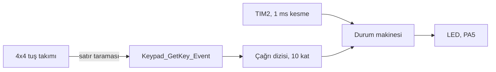
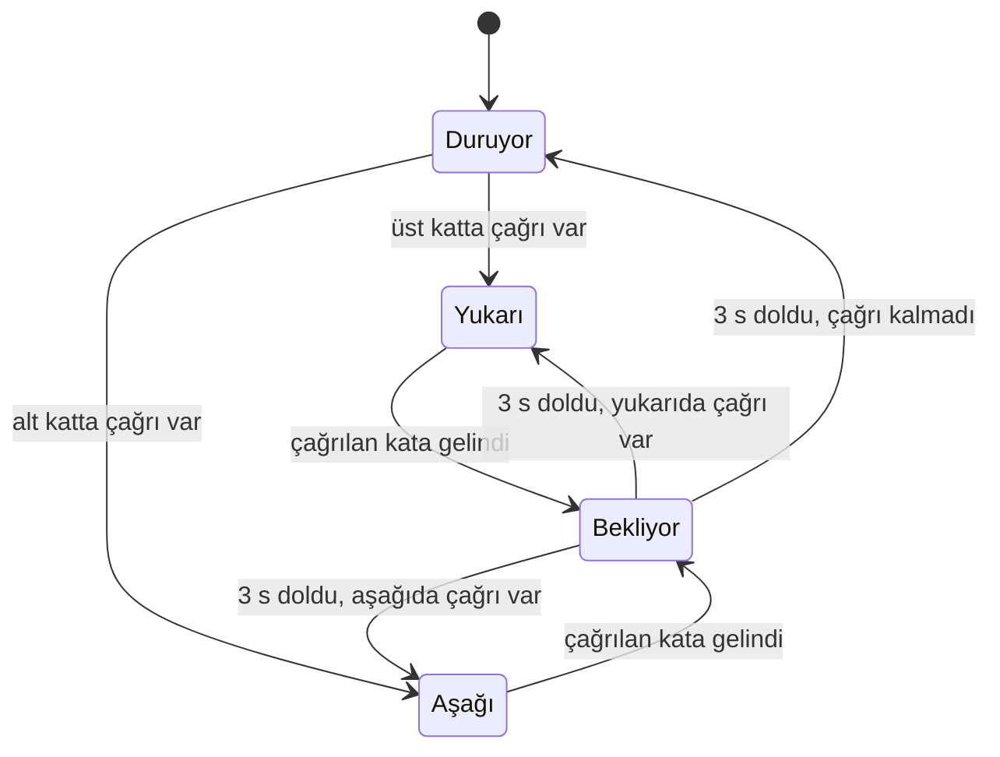

# STM32F091 ile asansör kontrol benzetimi (4x4 tuş takımı, durum makinesi)

10 katlı bir asansörün çağrı mantığını durum makinesiyle modelleyen uygulama. Katlar 4x4 tuş takımından çağrılıyor, asansörün hareketi kart üzerindeki LED'in yanıp sönme hızından izleniyor. Motor ya da kapı yok. Amaç çağrı sıralama algoritmasını ve durum geçişlerini denemek.

## Blok diyagram

## Durumlar

| Durum | LED | Süre |
|---|---|---|
| Duruyor | sürekli yanık | |
| Yukarı | 0.5 saniyede bir durum değiştirir | kat başına 5 saniye |
| Aşağı | 0.2 saniyede bir durum değiştirir | kat başına 2 saniye |
| Bekliyor | sürekli yanık | 3 saniye |

LED'in 10 kez durum değiştirmesi bir kat ilerlemek anlamına geliyor.

## Çağrı sıralama

Asansörlerde kullanılan tarama (SCAN) mantığı var. Kabin gittiği yönde çağrı kaldığı sürece o yönde devam ediyor ve yol üzerindeki çağrılarda duruyor. O yönde çağrı bitince yön değiştiriyor.

Örnek: kabin 2. kattayken sırayla 7, 4 ve 1 çağrılırsa önce 4'te, sonra 7'de duruyor, ardından dönüp 1'e iniyor. Kabin hareket halindeyken gelen çağrılar da hesaba katılıyor.

## Tuş takımı

| | Sütun 1 (PA11) | Sütun 2 (PB12) | Sütun 3 (PB11) | Sütun 4 (PB2) |
|---|---|---|---|---|
| Satır 1 (PB1) | 1 | 2 | 3 | A |
| Satır 2 (PB15) | 4 | 5 | 6 | B |
| Satır 3 (PB14) | 7 | 8 | 9 | C |
| Satır 4 (PB13) | * | 0 | # | D |

Satırlar çıkış, sütunlar dahili pull-up'lı giriş. Tarama sırasında satırlar sırayla 0'a çekiliyor ve sütunlardan 0 okunan varsa o tuş basılı demek oluyor. 20 ms sonra tekrar okunarak kontak sıçraması eleniyor. Tuş basılı tutulduğunda tekrar tekrar çağrı üretmemesi için sadece basılma anı sayılıyor.

0 ile 9 arası tuşlar kat çağırıyor. Harf tuşları, yıldız ve kare kullanılmıyor.

## Zamanlama

TIM2 milisaniyede bir kesme üretiyor ve durum makinesi bu kesmenin içinde çalışıyor. Bekleme ve LED süreleri milisaniye sayacından hesaplandığı için ana döngüdeki tuş taraması zamanlamayı bozmuyor.

## Derleme

STM32CubeIDE'de `File > Import > Existing Projects into Workspace` ile klasörü seç. İşlemci STM32F091RC, NUCLEO-F091RC kartıyla uyumlu. LED kartın üzerindeki yeşil LED.

## Lisans

MIT. `Drivers` klasöründeki STM32 HAL ve CMSIS dosyaları kendi lisanslarıyla gelir.

## Yazar

Gömülü Sistem Mühendisi M. Eyüb Can, [TECH-OHM](https://tech-ohm.com)
