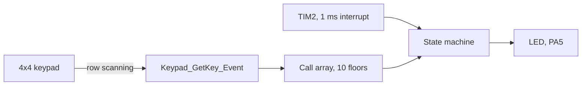
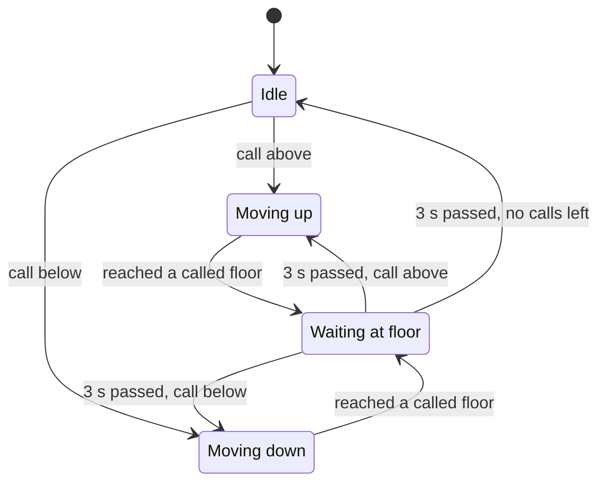

# Elevator controller simulation with a keypad and a state machine

STM32F091 · 4x4 keypad · SCAN scheduling · timer-driven FSM

   

**English** | [Türkçe](README.tr.md) · An open-source project by [TECH-OHM](https://tech-ohm.com)

An application that models the call logic of a 10-floor elevator as a state machine. Floors are called from a 4x4 keypad and the car's movement is shown by how fast the on-board LED blinks. There is no motor or door. The goal is to try out the call scheduling algorithm and the state transitions.

## Block diagram

## States

| State | LED | Time |
|---|---|---|
| Idle | on | |
| Moving up | toggles every 0.5 s | 5 seconds per floor |
| Moving down | toggles every 0.2 s | 2 seconds per floor |
| Waiting at floor | on | 3 seconds |

Ten LED toggles mean the car has moved one floor.

## Call scheduling

It uses the SCAN logic real elevators use. The car keeps going in its current direction as long as there are calls that way and stops at called floors along the path. When no calls remain in that direction it reverses.

Example: with the car at floor 2 and calls for 7, 4 and 1 in that order, it stops at 4, then 7, then turns around and goes down to 1. Calls made while the car is moving are taken into account too.

## Keypad

| | Column 1 (PA11) | Column 2 (PB12) | Column 3 (PB11) | Column 4 (PB2) |
|---|---|---|---|---|
| Row 1 (PB1) | 1 | 2 | 3 | A |
| Row 2 (PB15) | 4 | 5 | 6 | B |
| Row 3 (PB14) | 7 | 8 | 9 | C |
| Row 4 (PB13) | * | 0 | # | D |

Rows are outputs and columns are inputs with internal pull-ups. During a scan the rows are pulled low one at a time, and a column that reads low means that key is pressed. A second read 20 ms later filters contact bounce. Only the moment of pressing counts, so holding a key does not create repeated calls.

Keys 0 to 9 call a floor. The letter keys, star and hash are not used.

## Timing

TIM2 raises an interrupt every millisecond and the state machine runs inside it. Dwell and LED times are derived from the millisecond counter, so the keypad scan in the main loop does not disturb the timing.

## Build

In STM32CubeIDE use `File > Import > Existing Projects into Workspace` and select this folder. The MCU is an STM32F091RC, compatible with the NUCLEO-F091RC board. The LED is the green one on the board.

## License

MIT. The STM32 HAL and CMSIS files under `Drivers` keep their own licenses.

## Author

M. Eyüb Can, embedded systems engineer and founder of [TECH-OHM](https://tech-ohm.com)

## About TECH-OHM

[TECH-OHM](https://tech-ohm.com) designs electronic boards and embedded software, from the first schematic to series production. We also run a 12-month embedded systems training program and consult for engineering teams.

Web: [tech-ohm.com](https://tech-ohm.com) · Email: info@tech-ohm.com
